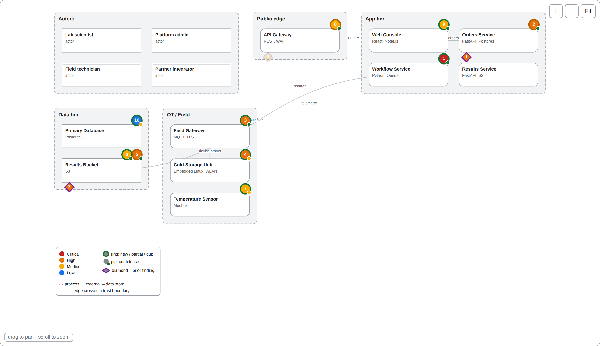

<h1 align="center">Lysis</h1>

<p align="center"><em>AI threat-model review agent — breaks a system design open to expose its threats, overlays prior findings, and builds the attack chains.</em></p>

<p align="center">
  
  
  
</p>

<p align="center"></p>
<p align="center"><sub>Every run auto-generates this interactive diagram: trust-zone layout, findings by severity, a prior-assessment overlay (violet diamonds), and clickable attack chains.</sub></p>

---

Lysis is a reusable, standalone agent for threat-model reviews. You give it the review artifacts
(architecture docs, DFDs, diagrams, PDFs, screenshots, optional code) and it returns ticket-ready
findings, a go-live decision, a readable report, and an interactive diagram. It runs on the Claude API.

What makes it more than a prompt: **the model proposes, and the code enforces.** Every judgment the
model makes is checked deterministically — CVSS computed from the vector, quotes verified verbatim
against the artifacts, code snippets verified against the repo, severity capped for undocumented
concerns, control gates generated, the go-live decision applied by rubric. You get findings you can
defend in a review, not a wall of generic hardening advice.

```
artifacts/ ──► 1 extract ──► 2 draft ──► 3 verify* ──► 4 critique ──► 5 finalize ──► enforce ──► findings.json
  docs, DFDs     system       STRIDE      read-only      second          apply          deterministic    report.md
  images, PDFs   model        threats     repo tools     reviewer        critique       validator        threat-model.html
                                          (*if --repo)
```

## Quick start

```bash
pip install -e .                   # Python 3.10+
export ANTHROPIC_API_KEY=...

lysis inspect path/to/artifacts                    # what will be sent + token estimate, no API calls
lysis review  path/to/artifacts --name "Payments API"
lysis review  path/to/artifacts --repo path/to/source --context notes.md
lysis review  path/to/artifacts --profile profiles/<you>.yaml
lysis batch   reviews/ --parallel 4               # each subfolder: artifacts/ [+ repo/] [+ context.md]
lysis eval                                        # re-run the eval suite and score it
```

Each run writes `runs/<system>-<timestamp>/`:

| File | What it is |
|---|---|
| `findings.json` | Ticket-ready output: one epic, exactly one Risk Assessment Story, and the Risk findings |
| `threat-model.html` | Interactive diagram with findings, prior-assessment overlay, attack chains, and presentation triage |
| `report.md` | Human-readable report: decision, summary table, system model, control gates, findings with evidence |
| `run.json` | Audit trail: artifact hashes, models, token usage, every enforcement fix, gate answers |
| `prior_findings.json` | Extracted prior-assessment findings, when one was provided |
| `system_model.json`, `draft.json`, … | The output of each pass, kept for debugging and tuning |

## Customize — one file

**Almost everything you'll change lives in one place: a profile.** Copy the template and edit the
commented fields:

```bash
cp profiles/template.yaml profiles/acme.yaml
lysis review path/to/artifacts --profile profiles/acme.yaml
```

The profile holds your control gates, SIEM name, required tags, standards pack, the model used per
pass — and two knobs that mean you never have to touch the prompts:

- **`extra_instructions:`** — methodology tweaks appended to the system prompt (e.g. *"treat any
  npm/pip supply-chain exposure as at least High"*).
- **`device_lens:`** — `auto` (apply the device/IoT/OT lens when the system includes hardware,
  gateways, instruments, or firmware), `true`, or `false`.

For one-off emphasis on a single review, pass notes with `--context notes.md` instead of editing anything.

<details>
<summary><b>Under the hood (advanced)</b></summary>

- `lysis_threatmodelagent/prompts/*.md` — the built-in methodology (one file per pass, plus the
  device lens). You rarely touch these.
- `lysis_threatmodelagent/enforce.py` — the deterministic checks. Developer territory.
- `standards/<pack>/*.md` — one standard per file; the first `# Heading` is the citable name.

See [`docs/sample-instructions.md`](docs/sample-instructions.md) for the full methodology written
out as a single prompt — useful if you want to run it in a no-code agent builder instead of the CLI.
</details>

## The interactive diagram

Every run (unless `--no-diagram`) writes a self-contained, offline `threat-model.html` built from
the extracted system model — the same view you'd otherwise draw by hand:

- **Trust-zone boxes**, each a nested container grid-packed across the canvas, with every finding
  placed on the component it's anchored to (fill = severity, ring = prior-assessment overlap, inner
  pip = confidence). DFD node shapes distinguish process / external / data store.
- **Attack chains** — the agent identifies sequences where one finding enables the next (leaked key
  → code execution → node-role compromise) and renders them as toggle buttons; a chain can mix
  design-review findings with prior pentest findings in the same path.
- **Presentation triage** — set each finding's status (Open / Remediated / False positive / Accepted)
  inline; filters hide categories; marks persist per-browser and export/import as JSON.
- **Pan / scroll-zoom / Fit**, light and dark, works in any browser.

## Prior assessments (pentest overlay + de-duplication)

If an artifact looks like a prior assessment — a pentest report, an audit, an earlier threat model —
Lysis extracts its findings and **overlays** them on the diagram as violet diamonds, then
**cross-tags** each new finding as `duplicate`, `partial`, or `none` versus the prior report, so a
client sees what's new vs. already on their fix list. Detection is automatic for pentest-looking
filenames; force it with `--prior <name>`.

## What it understands

| Input | Handling |
|---|---|
| `.md .txt .yaml .json .tf .py .ts …` | Sent as text; quotes are checked against it |
| `.drawio` / draw.io `.xml` | Parsed into elements, boundaries, and flows (compressed files supported) |
| `.mmd .mermaid .puml` | Diagram-as-code, sent as text |
| `.docx`, `.pptx` | Text, tables, and (pptx) speaker notes extracted |
| `.pdf` | ≤30 pages: sent as native PDF so Claude sees the diagrams; larger: extracted text. `--pdf-mode` to override |
| `.png .jpg .gif .webp` | Sent as images (quotes from images can't be verified) |
| `--repo PATH` | Not sent in bulk; the verify pass searches it through sandboxed read-only tools |
| `--context` / `context.md` | Reviewer notes, meeting notes, per-review emphasis |

## How it works

**Five passes, then deterministic enforcement.** Extract a system model → draft STRIDE threats →
(with `--repo`) verify against code using read-only sandboxed tools → an adversarial second reviewer
critiques → finalize applies the critique and builds attack chains. Then `enforce.py`:

- **Quote verification** — `evidence_quotes` must appear verbatim in a text artifact; fabricated
  quotes are stripped and a `direct` finding without a surviving quote is downgraded to `inference`.
- **Code-snippet verification** — cited `file:line` snippets must exist near those lines in the repo.
- **Missing documentation caps severity** — `absence_of_documentation` findings are capped at Medium.
- **Actionability is derived, not chosen** — from confidence × severity × evidence basis.
- **CVSS computed from the vector** (v3.1), never supplied by the model; large rubric mismatches flagged.
- **Known reference formats only** — OWASP / ATT&CK / NIST / CWE must match known formats; a standard
  must exist in the loaded pack.
- **Control gates** — no gate goes unanswered; a "No", an evidence-free "Yes", or an "Unknown"
  produces its own finding.
- **Go-live by rubric** — any Critical/High blocks "Approved"; ≥2 Criticals is "Not Approved".
- **Story ticket** — the single Risk Assessment Story is built entirely in code, so it can't be malformed.

**Prompt caching** keeps a five-pass run cheap: the policy, standards, gates, and artifacts form a
cached prefix that passes on the same model read from cache.

## Docs

- [`docs/system-owner-questionnaire.md`](docs/system-owner-questionnaire.md) — a 53-question intake
  questionnaire for system owners; its answers feed a review and the control gates.
- [`docs/sample-instructions.md`](docs/sample-instructions.md) — the full methodology as a single
  paste-in prompt, for running it in a no-code agent builder (CLI users don't need this).

## Evals & tests

```bash
lysis eval                         # scores every case in evals/cases/ on recall, severity, FPs, decision
pip install -e ".[dev]" && pytest -q
```

`evals/cases/labshare` is a fictional multi-tenant system with planted issues (a cross-tenant
export, an unauthenticated webhook, 7-day pre-signed URLs, SIEM forwarding that isn't in place) and
a decoy (all SQL is parameterized, so a SQL-injection finding counts as a false positive). The tests
run the full pipeline offline against a fake client that returns deliberately flawed output, and
assert the validator catches each flaw.

## Data handling

Artifacts are sent only to the Anthropic API. For client data, use an organization with an
appropriate data-retention agreement (e.g. zero data retention), and keep `runs/` and `reviews/` out
of source control — they're already in `.gitignore`.

## License

Apache-2.0. See [`LICENSE`](LICENSE).
